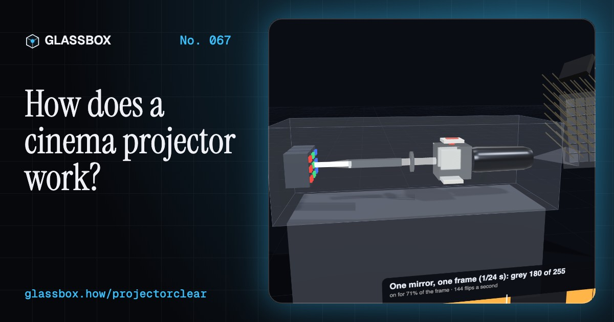
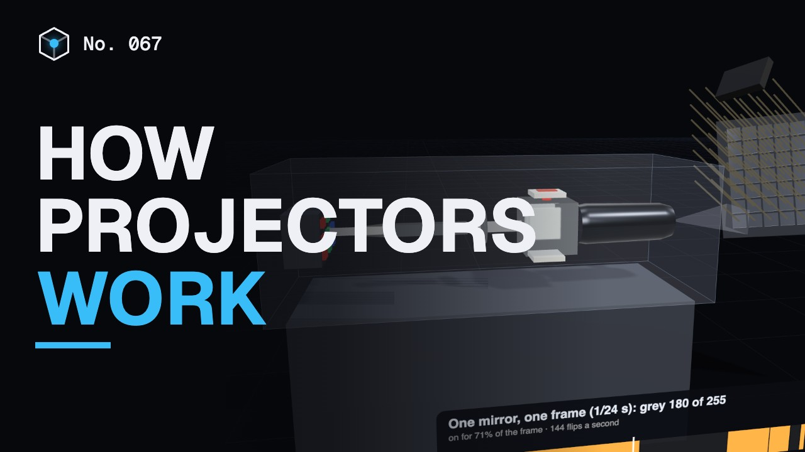
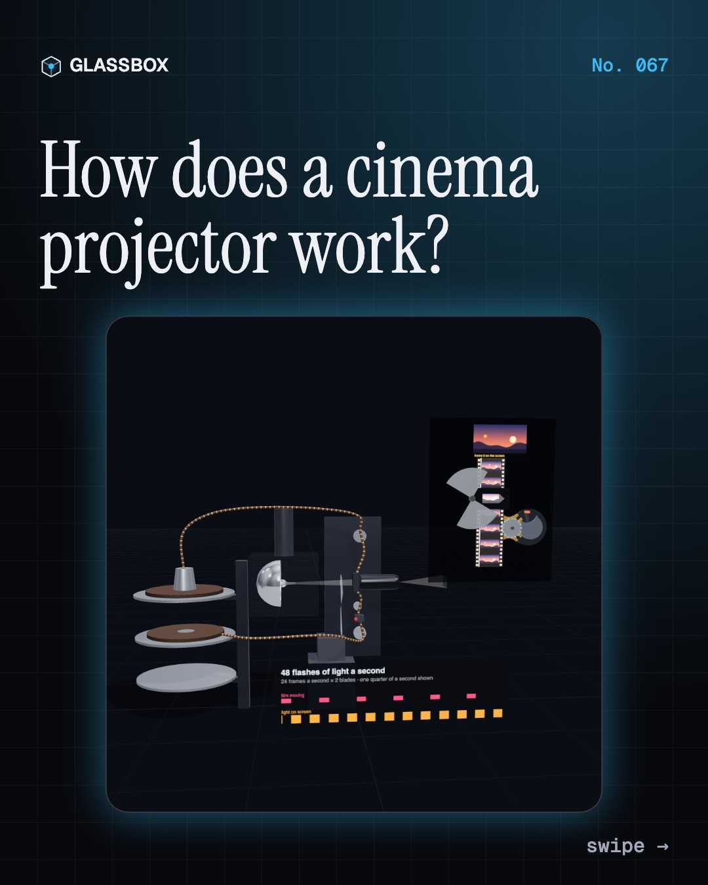
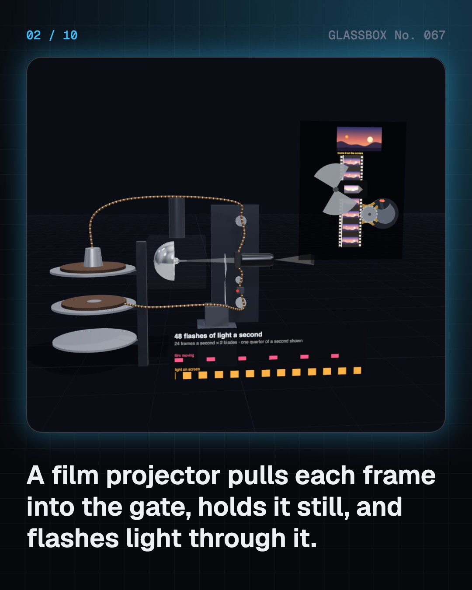
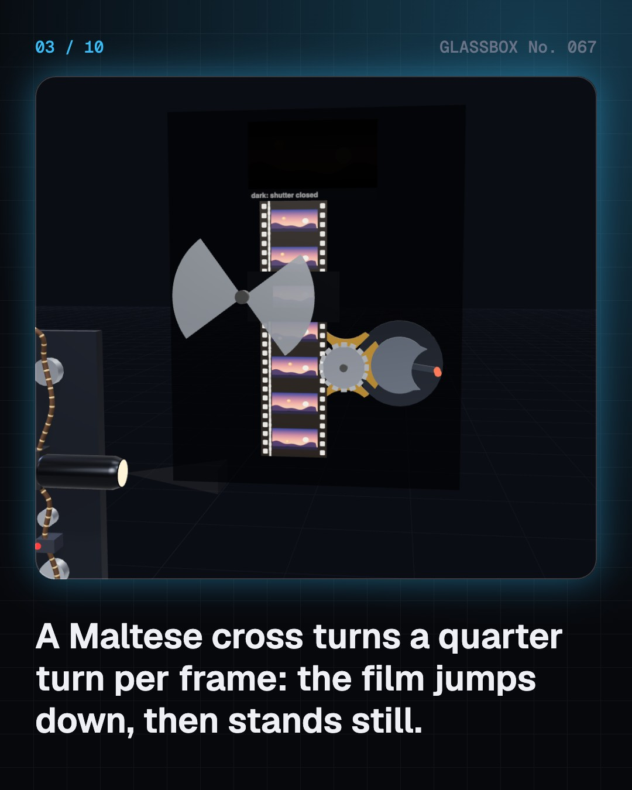
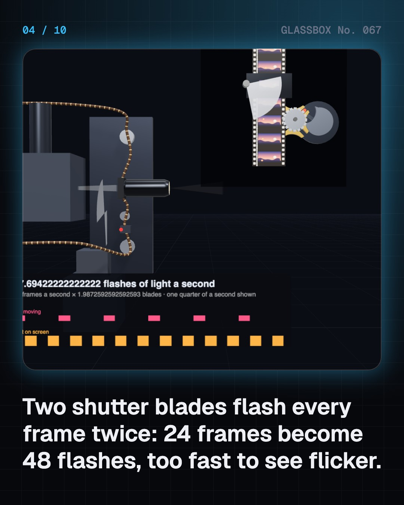

<!-- glassbox:start -->
<!-- Generated from glassbox.json by the Glassbox hub (npm run readme -- projectorclear). Edit glassbox.json, not this block. -->
<p align="center"><a href="https://glassbox-production-fd52.up.railway.app/e/projectorclear/"></a></p>

<h1 align="center">ProjectorClear</h1>

<p align="center"><b>How does a cinema projector work?</b><br>A Maltese cross that stops the film 24 times a second, a shutter that flashes every frame twice, and a chip with 9 million tilting mirrors. Step into the booth and see how a cinema throws a picture 30 metres onto a wall.</p>

<p align="center"><a href="https://glassbox-production-fd52.up.railway.app/projectorclear/"><b>▶ Play with it</b></a> &nbsp;·&nbsp; <a href="https://glassbox-production-fd52.up.railway.app/e/projectorclear/">Read the 60-second explainer</a> &nbsp;·&nbsp; <a href="https://glassbox-production-fd52.up.railway.app/projectorclear/glassbox/reel.mp4">Watch the 40-second video</a></p>

<p align="center">
  <a href="https://glassbox-production-fd52.up.railway.app/e/projectorclear/"></a>
  <a href="https://glassbox-production-fd52.up.railway.app/e/projectorclear/"></a>
  <a href="LICENSE"></a>
  <a href="LICENSE-CONTENT.md"></a>
  <a href="#privacy"></a>
</p>

## In 60 seconds

1. **Film stops, flashes, then jumps.** A 35 mm projector pulls film from a platter through a gate. A Maltese cross turns a steady spin into a quarter-turn jerk: the film moves one frame in about 10 ms, then stands still for 31 ms. A two-bladed shutter hides the jump and flashes each frame twice, so 24 frames become 48 flashes, fast enough that the flicker disappears.
2. **Nine million mirrors per colour.** A digital cinema projector splits lamp or laser light into red, green and blue, one DLP chip each. A 4K chip has 4096 × 2160 mirrors about 7.5 µm apart that tilt ±12°. Grey comes from timing: each mirror flips on and off thousands of times a second, and your eye averages the flashes.
3. **The lens sets the size, the screen sets the brightness.** Picture width = throw × chip width ÷ focal length. Tilting a high projector makes a keystone, so cinemas use lens shift. The DCI standard asks for 14 fL (48 cd/m²); a silver screen is about 2.4× brighter straight on but dim from the side.
4. **3D is two films sharing one screen.** One projector flashes left and right pictures 144 times a second. Polarised, active-shutter or colour-filter glasses let each eye see only its own picture. Each eye gets its picture half the time, and filters swallow more, so roughly a fifth of the light arrives.
5. **A film in files, locked with a key.** Films arrive as a DCP: JPEG 2000 frames at up to 250 Mbit/s, roughly 150 to 250 GB for a feature, by drive, internet or satellite (India's UFO Moviez and Qube pioneered satellite delivery). The files are encrypted and only play when a KDM key, made for that one server, is valid.
6. **Bigger, faster, brighter.** IMAX runs 70 mm film sideways, 15 perforations a frame, about ten times the area of 35 mm, and now uses twin lasers. Some films tried 48 or 120 fps. LED screens such as Samsung Onyx (2017) need no projector at all, while India's single screens give way to multiplexes.

## Words worth knowing

| Term | Meaning |
|---|---|
| **Geneva drive** | A pin wheel and slotted Maltese cross that turn smooth rotation into quick quarter-turn steps. |
| **Rotary shutter** | A spinning bladed disc that blocks light while the film moves and flashes each frame, usually twice. |
| **Flicker fusion** | The flash rate above which light looks steady; at cinema brightness roughly 40 to 50 Hz. |
| **DMD** | A digital micromirror device: a chip of millions of hinged mirrors, one per pixel, tilting on or off. |
| **Pulse-width modulation** | Making in-between brightness by switching fully on and off and varying the on time. |
| **Throw ratio** | Distance to the screen divided by picture width, set by the lens focal length. |
| **Foot-lambert** | A unit of screen brightness; the DCI standard is 14 fL, or 48 cd/m². |
| **Screen gain** | How much brighter a screen looks straight on than matte white; silver is about 2.4. |
| **DCP and KDM** | The Digital Cinema Package of encrypted files, and the Key Delivery Message that unlocks it for one server and time window. |

## A short history

**360 years from a candle behind painted glass to laser light, micromirror chips and glowing LED walls.**

- **1659** · The magic lantern (Christiaan Huygens, The Hague, Dutch Republic)
- **1895** · The first paid film show (Auguste and Louis Lumière, Salon Indien, Grand Café, Paris)
- **1896** · Moving pictures reach India (Marius Sestier, for the Lumières, Watson's Hotel, Bombay)
- **1896** · The Maltese cross (Oskar Messter, Max Gliewe and Robert W. Paul, Berlin, Germany, and London, England)
- **1970** · IMAX opens at Expo '70 (Graeme Ferguson, Roman Kroitor, Robert Kerr and William Shaw, Fuji Group Pavilion, Expo '70, Osaka)
- **1987** · A chip made of tiny mirrors (Larry Hornbeck, Texas Instruments, Dallas, Texas)
- **1999** · The first digital cinema screenings (Lucasfilm, Texas Instruments and Hughes-JVC, Los Angeles area and New Jersey)
- **2005** · One standard for digital cinema (Digital Cinema Initiatives (DCI), Hollywood, California)

The full story, with 30 moments, charts, people and 45 sources: [glassbox.how/e/projectorclear/history](https://glassbox-production-fd52.up.railway.app/e/projectorclear/history/). The data lives in [`history.json`](history.json).

## Video and slides

Made with the Glassbox studio from this box's storyboard (`window.glassbox.director`). Free to reuse under CC BY 4.0.

<a href="https://glassbox-production-fd52.up.railway.app/projectorclear/glassbox/video.mp4"></a>

<p><a href="glassbox/slide-1.jpg"></a> <a href="glassbox/slide-2.jpg"></a> <a href="glassbox/slide-3.jpg"></a> <a href="glassbox/slide-4.jpg"></a></p>

| File | What | Size |
|---|---|---|
| [`glassbox/reel.mp4`](https://glassbox-production-fd52.up.railway.app/projectorclear/glassbox/reel.mp4) | Reel / Short, with captions and soundtrack | 1080×1920 |
| [`glassbox/video.mp4`](https://glassbox-production-fd52.up.railway.app/projectorclear/glassbox/video.mp4) | YouTube video, with captions and soundtrack | 1920×1080 |
| `glassbox/slide-1…10.jpg` | Instagram carousel | 1080×1350 |
| `glassbox/thumb.jpg` | YouTube thumbnail | 1280×720 |
| `glassbox/cover.jpg` | Share card and repo social preview | 1200×630 |
| [`glassbox/history-reel.mp4`](https://glassbox-production-fd52.up.railway.app/projectorclear/glassbox/history-reel.mp4) | “History in 10 moments” Reel / Short | 1080×1920 |
| `glassbox/history-slide-*.jpg` | History carousel | 1080×1350 |
| `glassbox/post.json` | Post copy and schedule used by the publish kit | |

## Privacy

This box has no accounts and no ads, and it ships its own fonts and libraries. When you run it yourself it sends nothing anywhere. On glassbox.how, the site's `/bar.js` also loads Glassbox's analytics: **Google Analytics** to count visits (it asks first in the EU, UK and Switzerland, and stays off when your browser sends Global Privacy Control or Do Not Track) and **ClickTrust** to detect bots.

It remembers a few things **in your own browser only**, and never sends them anywhere:

| Browser storage key | What it holds |
|---|---|
| `projectorclear.v1` | Which chapters you have opened, your best quiz scores, and sound on or off. |

Exactly what each one sees is at [glassbox.how/privacy](https://glassbox-production-fd52.up.railway.app/privacy/).

## Licences

- **Code:** [MIT](LICENSE). Use it, change it, ship it.
- **Explanations, text, images and videos** (`glassbox.json`, `glassbox/`): [CC BY 4.0](LICENSE-CONTENT.md). Credit “Glassbox, glassbox.how/e/projectorclear”.
- **Third-party parts** keep their own licences: [three.js](https://threejs.org) (MIT), [Geist, Instrument Serif](https://openfontlicense.org) (SIL OFL 1.1).
- The Glassbox name and logo aren't covered by either licence. See the [terms](https://glassbox-production-fd52.up.railway.app/terms/).

Found a mistake? [Open an issue](https://github.com/bdeeps/projectorclear/issues). Corrections happen in public.
<!-- glassbox:end -->

## Run it

It's plain HTML, CSS and JavaScript. No build step and no dependencies. Run locally, it contacts no other website.

```bash
python3 -m http.server 8000
```

Three.js and the fonts ship in `vendor/` and `fonts/`, so it also works offline.

Then open http://localhost:8000.

## How it's built

| File | What |
|---|---|
| `index.html`, `css/app.css` | The page and its styles |
| `js/app.js`, `js/stage.js`, `js/ui.js`, `js/kit.js` | The shared Glassbox 3D engine: chapters, 3D stage, controls, quiz, video director |
| `js/chapters/*.js` | One file per chapter: the 3D model, controls, text, key terms, quiz and video scenes |
| `js/projector.js` | Shared projector helpers: 35 mm and Geneva-drive maths, DCI numbers, the generic test film, boards, seats and a generic digital projector |
| `glassbox.json` | Title, question, explainer beats, key terms, browser storage and credits shown on glassbox.how |
| `reel` in each chapter | The storyboard the Glassbox studio records into short videos |
| `glassbox/` | The published video, slides, thumbnail and post copy |
| `fonts/`, `vendor/three/` | Self-hosted Geist and Instrument Serif (SIL OFL 1.1) and three.js (MIT) |
